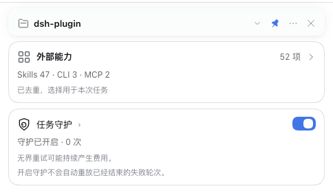

# 外部能力 · Capability Selector

在 DSH 会话摘要下方提供与摘要、任务守护等宽的能力入口卡片，显示能力总数、Skills / CLI / MCP 分类统计和去重说明。统一查看本机已安装的 Skills、企业 CLI 和 MCP 配置，搜索、筛选、多选后将准确的使用说明追加到当前输入框。纯 JavaScript，无运行时依赖，无需构建，Node.js 22+。

## 使用

1. 打开一个会话，右侧摘要下方会显示“外部能力”卡片，并在后台只读发现能力以显示统计。点击整张卡片打开选择面板；之后使用短期缓存，点击面板中的“刷新”重新扫描。扫描失败时保留明确提示，由点击入口或“重试”再次扫描，不循环重试。
2. 按 Skills / CLI / MCP、来源或关键词筛选。点击名称查看说明、安装位置和依赖线索；复选框用于多选。
3. 点击“添加到输入框”。插件使用 DSH 原生追加接口，保留已有草稿、引用与附件，不自动发送。
4. 确认输入框中的任务及能力说明后，由用户发送。选择表示当前任务的使用偏好，不等于全局启用、禁用或安装能力。

输入框正在提交、附件处理未完成或绑定已变化时，会保留选择并提示重试。切换主会话后清空面板选择，避免把能力说明加到另一个会话。原生接口缺失时可用“复制使用说明”。

## 自适应布局

- 入口是独立卡片，不放入摘要内容的滚动容器；白底 / 主题底色、细描边、圆角和留白与任务守护一致。右侧数量和箭头提示打开选择面板。
- 配合本仓库的 Session Summary 0.3.3+，按整列实测高度为能力卡片和附件预留空间，摘要只使用实际剩余的高度。摘要变长时内部滚动，不会覆盖下方入口；短窗口折叠卡片辅助说明、极矮窗口只保留标题和数量。
- 卡片列过长时可单独滚动；无需滚动摘要才能打开选择器。
- 0.1.2+ 声明 `capability-selector.accessories` 原生子插槽（root scope/list）；注册组件接收当前 `sessionId`。任务守护、常用对话、待办和会话摘要都使用该插槽，不需要查找或操作外部能力 DOM。
- 摘要折叠、展开或窗口缩放时，卡片栏随之重新定位。

## 卡片排序与显示（0.3.0+）

右侧卡片栏是一套通用能力：「外部能力」自身和注册到 `capability-selector.accessories` 的每个组件都是一张卡片，可以拖动排序、隐藏和重新显示。新插件只要注册到这个插槽，就会自动加入，不需要额外代码。

- 悬停卡片时，标题左侧出现六点把手。按住把手拖动：卡片脱离卡片栏跟随指针，原位置显示蓝色虚线框，其他卡片实时让位；松手后卡片滑入虚线框。拖到卡片栏上下边缘会自动滚动。按 Esc 取消。
- 点按把手打开菜单：「隐藏」或「管理卡片…」。有卡片被隐藏时，卡片栏底部显示「已隐藏 N 张卡片 · 管理卡片」。管理面板里可以逐个开关卡片，或「恢复默认」顺序和显示。
- 默认顺序按注册的 `order` 排列：会话摘要 −10、外部能力 0、常用对话 50、待办 60、任务异常提醒 100。新注册的卡片插在默认位置旁边，不打乱已保存的顺序；暂时停用的插件重新启用后回到原来的位置。
- 顺序和隐藏状态保存在本浏览器的 `localStorage`（键 `dsh-capability-selector.cards.v1`），刷新、重启后保留；不跨设备同步。
- 组件注册时建议提供 `label`（字符串或函数），用于把手、菜单和管理面板；缺省时显示注册 `id`。组件返回空内容时，它的卡片位置自动隐藏。
- 宿主不支持枚举插槽注册项时，退回原来的固定顺序。

验证截图：[拖动中](docs/card-stack-drag.png)、[排序后](docs/card-stack-reordered.png)、[卡片管理](docs/card-stack-manage.png)。
- 宽屏优先向左展开选择面板；空间不足时居中；窄屏使用单列面板，列表和详情可来回切换。
- 面板高度限制在可视窗口内，列表、详情单独滚动，底部操作区始终可访问；使用 visualViewport 适配可视区域变化。
- 关闭摘要或未安装摘要时，入口回到主会话页头右侧下方。插件也可以单独安装。
- 0.2.1+ 右侧栏展开时，能力卡片及其附件（含任务守护）一起隐藏，不再预留空间，已打开的选择面板随之关闭；收起侧栏后恢复。侧栏展开期间，如果在摘要页头按钮中临时显示了摘要，能力卡片也会跟着出现在摘要下方。
- 支持浅色 / 深色主题、Escape 关闭、键盘选取；窄屏弹层包含焦点循环。

布局协作约定是根元素 CSS 变量 `--dsh-summary-accessory-height` 与 `dsh:summary-accessory-change` 事件。停用时释放预留空间、观察器、事件和样式，不修改摘要内容 DOM。

## 发现范围

扫描发生在 DSH Host 所在机器上。浏览器远程访问 DSH 时，清单对应 Host 的安装情况。

| 类型 | 默认范围 | 状态含义 |
|---|---|---|
| Skills | 当前工程至 Git 根或用户目录的 `.codex/skills`、`.claude/skills`、`.dsh/skills`、`.agents/skills`；相应用户级目录；DSH 当前运行时 Skill 注册表；自定义目录 | 已安装；完整性不能确认时标记待核对 |
| CLI | PATH 与用户 `.local/bin` 中的 `o2` / `oxygen-cli`、`digger`、`jd-login`，可配置扩展命令名 | 仅检查可执行文件，不验证登录 |
| o2 子能力 | `o2 list --installed --json` 返回的已安装目录 | 只读发现，失败或超时产生提示，保留 o2 本身的安装信息 |
| MCP | Codex 用户及工程配置、Claude 用户及工程配置、DSH 当前 profile 已合成的 MCP 条目 | 已配置或已禁用，不冒充已连接、已登录或当前会话已可调用 |

支持 `CODEX_HOME`、`CLAUDE_CONFIG_DIR`、`DSH_HOME` 等显式目录覆盖。不会遍历整块硬盘。扫描限制目录深度、文件大小、总读取量与耗时；局部失败时保留其他结果并显示扫描提示。

MCP 配置中只提取名称、来源、传输类型与启停状态，不向客户端返回启动参数、环境变量、地址中的凭据、请求头或完整配置。展示 Skill 文本时也过滤明显凭据。不会因为发现某项能力而自动登录、连接 MCP、安装工具或执行业务。

## 去重规则

- 同一真实 Skill 路径通过符号链接出现在不同 Agent 下时，合并来源。
- 不同目录中完整 Skill 包一致时合并，包括正文、脚本、资源文件名、内容与可执行位。
- 同名不同内容保留独立条目；扫描不完整或依赖包外资源时不跨目录误合并。
- 不可读取文件的 DSH provider Skill 按 provider 身份保留，并指引调用原生 Skill 工具。
- `oxygen-cli` 作为 `o2` 的别名合并；o2 子能力单独显示。
- MCP 仅在名称和完整配置指纹一致时合并。指纹只留在 Host 内部，不返回敏感配置。

## 安装

在 DSH 的“插件 → 安装第三方插件”中填入本目录的绝对路径，启用后刷新现有 DSH 页面。需要与摘要联动时，同时使用本仓库更新后的 `session-summary`。

```sh
dsh plugin --profile desktop add /absolute/path/dsh-plugin/capability-selector
```

macOS 未配置 PATH 时可使用官方启动器：

```sh
"/Applications/DeepSeek Harness.app/Contents/Resources/runtime/cli/bin/dsh" plugin --profile desktop add /absolute/path/dsh-plugin/capability-selector
```

如插件管理器报告需要重启，等待当前任务结束后再重启。无需启动额外 Web 服务。

## 配置

插件条目的 `config` 可填写以下内容，未填写使用默认值：

```yaml
extraSkillRoots: []                 # 最多24个绝对路径，支持 ~/
cliCommands: [o2, oxygen-cli, digger, jd-login]  # 最多24个命令名，不接受参数或路径
cacheTtlMs: 60000                   # 1000..300000
enableO2Discovery: true             # 只读发现o2已安装子能力
enableAgentTool: true               # 注册只读 capability_list 工具
```

前端请求只接受会话 ID，工作目录由 Host 读取会话当前目录解析，不能由浏览器指定任意扫描目录。

## 截图与验收



查看[验收记录](docs/验收记录.md)、[窄屏卡片](docs/card-stack-mobile.png)及[深色主题](docs/card-stack-dark.png)。截图使用真实组件和测试样例数据。原有[能力面板](docs/preview.png)继续提供搜索、筛选和多选。

## 开发与验证

```sh
npm run check
npm test
npm run test:integration
npm run test:browser
npm run test:cards                # 摘要 + 能力入口 + 任务守护的三卡片联动
npm pack --pack-destination artifacts
```

原生后端集成测试读取 `scripts/.runtime` 或同仓库 `side-branch/scripts/.runtime` 的已提取宿主依赖，也可用 `DSH_TEST_RUNTIME` 指定依赖根目录；没有依赖时该项会明确跳过。浏览器测试直接从本机安装包读取所需模块。

浏览器检查使用隔离 Chrome 和本机 DSH 安装包中的真实 React / 主题，加载实际选择器和摘要源码，不访问用户会话或认证信息。截图和测试数据位于 `tests/.integration-data`，不提交仓库。

插件依赖 DSH `0.2.1-rc.3` 的公开插槽、`uiSession.current` 和原生 `requestDraftInitialization(..., { whenDraftExists: 'append' })` 接口；升级宿主后需要重新验证。
