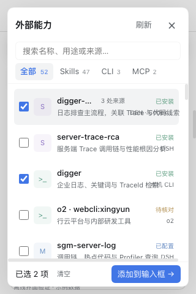

# 验收记录

## 版本与安装

- Capability Selector：0.2.0。
- Session Summary：0.3.3，支持完整能力卡片和附件的动态高度预算。
- 宿主：DSH 0.2.1-rc.3，commit `be72761`。
- 已通过官方 CLI 将本地开发目录安装至 `desktop` profile；依赖安装退出码 0。
- 当前 GUI 地址 `http://127.0.0.1:65267` 的 `/plugins/events` graph 同时包含 `dsh-capability-selector` 和 `dsh-session-summary`；逐个读取客户端资源均返回 HTTP 200，并确认包含新卡片和摘要高度预算代码。
- 已在当前真实会话调用 `capability_list(refresh:true)`：返回 33 项（22 Skills、7 CLI、4 MCP），覆盖 DSH runtime 的 Office Skills 与当前 profile 的 SGM MCP。
- 本机扫描中的部分 Skill 包引用父目录资源或达到资源读取上限，标记为“待核对”并保留独立条目；不是无结果，也不把不能证明相同的包强行合并。

插件安装与 Host 发现已在实际运行实例验证。GUI 组件交互使用下面说明的隔离浏览器测试；没有接管用户已登录的浏览器或自动发送用户消息。安装后刷新现有 GUI 页面可确保加载最终客户端版本。

## 自动检查

| 检查 | 结果 |
|---|---|
| 选择器语法检查 | 通过 |
| 选择器前后端单元测试 | 34 / 34 |
| 摘要插件单元回归 | 26 / 26 |
| 真实 Cordis 后端集成 | 1 / 1，0 跳过 |
| Chrome 能力面板及入口交互检查 | 94 / 94，0 浏览器错误 |
| 原有摘要 / 能力 / 任务守护联动检查 | 33 / 33 |
| 完整卡片外观、动态预留与滚动专项检查 | 19 / 19，0 浏览器错误 |

后端原生集成验证实际 Cordis 插件挂载、runtime Skills / Office provider、当前 profile MCP、会话 API、只读 Agent 工具、资源释放。

浏览器使用安装包中的真实 React、主题、Lexical 与原生 InputHub；加载实际选择器和摘要源码，在 file 页面中使用虚构会话与能力数据，不发模型请求。对原生输入模块的测试副本只增加了测试用导出，追加、引用与附件处理保留宿主原始实现。

## 自适应及交互场景

- 摘要展开至长列表，内部滚动，按钮持续位于摘要下方且不进入摘要滚动区。
- 正文滚动、真实鼠标拖动摘要、摘要回到靠边布局、窄屏展开摘要后，按钮仍在可视区域内。
- 1440×900、1440×480、760×900、760×480、760×190、320×480、320×190。
- 极矮窗口覆盖宿主输入框 / 按钮的最小高度，保留可操作的能力列表区域及底部添加按钮。
- 宽屏面板优先向左展开；窄屏单列列表 / 详情切换；面板、列表、详情滚动不影响底部操作区。
- 关闭摘要或不装摘要时，选择器可独立工作并使用主会话页头作为锚点。
- 浅色 / 深色主题，不透明面板背景。
- 搜索、类型 / 来源 / 安装状态筛选，多选、来源去重、详情读取。
- Escape 关闭并恢复按钮焦点，外部点击关闭，保持固定摘要可见。
- 原生追加保留未发送草稿、语义文件引用与已有附件；不自动提交。
- 输入框 busy、切换主会话、相同 ID 的 binding generation 被替换时拒绝错误写入。
- 卸载清理入口、面板、样式、观察器、事件和预留空间，重新加载不产生重复入口。

## 0.2.0 统一入口卡片

根据用户确认的三卡片效果图，将独立小按钮替换为与摘要、任务守护等宽的入口卡片：

- 入口使用任务守护同款主题底色、细描边、圆角和留白；整张卡片支持点击、键盘和焦点提示。
- 标题行包含能力图标、名称、总数和向右箭头，下面展示 Skills / CLI / MCP 统计及去重说明；已选数量显示在卡片内。
- 首次进入会话会后台只读发现能力以填充统计，不自动登录或连接服务；发现失败时等待明确重试，不循环请求。
- 保留原生 `capability-selector.accessories` 插槽，任务守护继续位于能力卡片下方，按整列实测高度为摘要预留空间。
- 卡片列较高时单独滚动，能力入口固定在列顶部；窗口高度不超过 360px 时隐藏辅助说明，不超过 280px 时只保留主行。
- 配套 Session Summary 0.3.3 按实际剩余窗口空间计算摘要上限，避免附件高度被重复从摘要比例上限中扣除。

## 0.1.1 长文本重叠修复

用户反馈长描述越过列表文本列，与右侧来源标签重叠。原因是描述为行内 span，原有 overflow / text-overflow 没有约束其绘制宽度。

- 描述改为有宽度约束的块元素，超长内容在本列内省略。
- 文本容器、标题及来源列分别裁切，长名称、同名版本和多来源标签不能相互侵占。
- 增加长中文、连续英文、超长同名版本和长来源名称样例，检查每行文本边界以及列表横向溢出。
- 修复前新增回归检查在 6 个场景失败；修复后完整浏览器检查 78 / 78 通过，包含 1000×900、760 宽和 320 宽窗口。
- 当前 GUI 提供的插件脚本返回 HTTP 200，并确认含有修正后的描述样式；刷新现有页面可加载补丁。

[长描述修复截图](text-overflow-fix.png)

## 截图

截图来自上述真实组件的离线浏览器测试，清单数据为测试样例。

[窄屏卡片](card-stack-mobile.png) · [深色卡片](card-stack-dark.png)

新增专项检查在 899×900 的原生折叠摘要布局、深色主题、760×480、320×480 和 320×190 下验证等宽对齐、上下顺序、实测预留高度及可视区域边界；插入 1100px 高的附属内容并滚动后，能力卡片保持固定在列顶部且可通过真实鼠标点击打开面板；移除后预留空间恢复。

以下为能力选择面板的既有截图：

## 边界

- 扫描的是 DSH Host 本机及已支持的已知目录，可以配置额外 Skill 路径；不是全磁盘扫描。
- CLI 的“已安装”、MCP 的“已配置”不代表登录就绪、已连接或当前会话拥有可调用工具。
- Codex TOML 采用受限只读提取，复杂 inline table 等语法报告部分解析。
- Windows 下 `o2` 若只提供 `.cmd` / `.bat`，保留安装信息，但子能力发现会报告不支持直接启动，不自动改用 shell。
- DSH 升级后需要重跑原生接口与浏览器验证。
