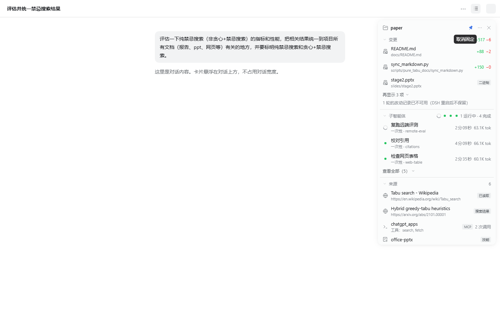
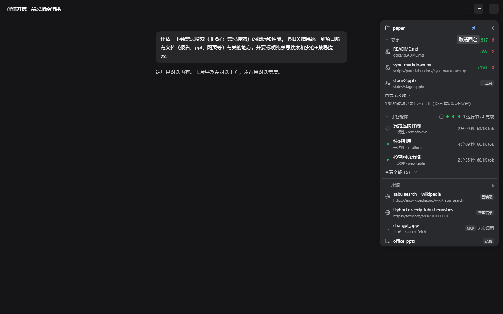
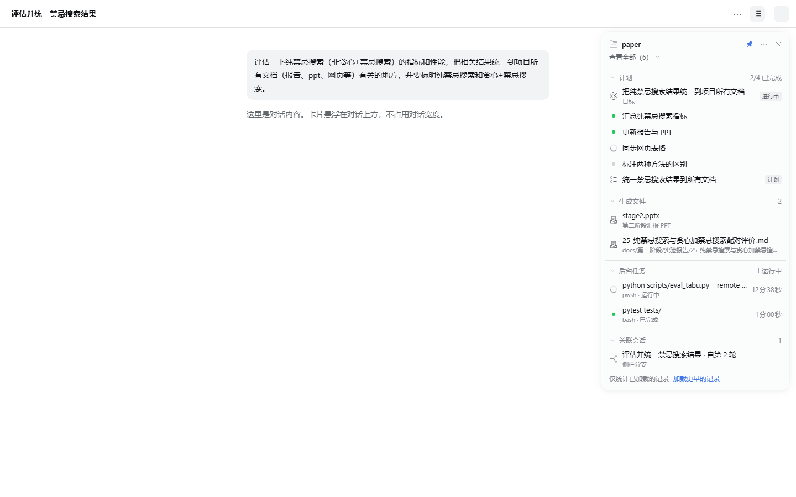

# 会话摘要悬浮框 · 使用文档

适用版本：插件 `0.3.0`，DSH `0.2.1-rc.3`（Desktop 和 Web 都能用）。

会话摘要悬浮框在对话页头右上角加了一个按钮，每次打开窗口时都会默认打开并固定一张可拖动的摘要卡片，默认靠边显示以避开会话正文，集中显示当前会话**改了哪些文件、子智能体跑得怎么样、参考了哪些来源、计划进行到哪一步**，等等。卡片里的每一项都能点，点了会直接打开 DSH 自己的对应页面。卡片的样子和用法参照的是 Codex 桌面版右上角的 pinned summary。



> 本文的截图来自离线预览，数据是示例，和你实际会话里的内容会不一样。

---

## 1. 安装

安装或更新后刷新页面以载入客户端代码；若插件管理器提示需要重启，等当前任务结束后再重启。

1. 在 DSH 左侧栏打开“插件”，点击“添加插件”。
2. 在输入框里填写 `session-summary` 目录的绝对路径，然后点击“安装”：
   - macOS 例如：`/Users/<你的用户名>/dsh-plugin/session-summary`（在终端进入该目录执行 `pwd` 可得到路径）
   - Windows 例如：`E:\dsh-plugin\session-summary`
   - 也可以先在该目录执行 `npm pack --pack-destination artifacts`，再填写生成的 `artifacts/dsh-session-summary-0.3.0.tgz` 的绝对路径
3. 安装完成后，打开一个**已经有对话**的会话，页头右上角就能看到按钮。

也可以在 `session-summary` 目录中用命令行安装：

```sh
# macOS
"/Applications/DeepSeek Harness.app/Contents/Resources/runtime/cli/bin/dsh" plugin --profile desktop add "$PWD"
```

```powershell
# Windows PowerShell（把安装目录换成你的 DSH 安装位置）
& "D:\DeepSeek Harness\resources\runtime\cli\bin\dsh.cmd" plugin --profile desktop add "$PWD"
```

如果 `dsh` 已在 PATH 中，直接执行 `dsh plugin --profile desktop add <路径>` 即可。

如果安装结果提示需要重启，等手头的任务跑完再重启 DSH。

---

## 2. 打开、关闭和固定

### 按钮在哪里

按钮在对话页头的最右边，紧挨着原生“展开右侧栏”按钮的左边，图标是三行列表。鼠标悬停半秒会出现提示“显示会话摘要”。

- 有子智能体正在运行时，按钮右上角会出现一个**蓝色小圆点**，不用打开卡片也能知道后台还有任务在跑。
- 卡片打开时，按钮会保持按下状态。

> **空白会话**（还没发第一条消息的会话）的页头不显示原生工具按钮，所以这个按钮也不会出现。发出第一条消息后就会显示。

### 打开和关闭

每次打开或刷新窗口，卡片都会打开并固定，默认仅展开“变更”。手动关闭、取消固定或展开其他板块只影响当前窗口；旧版保存的关闭状态不会阻止下次启动显示。

| 操作 | 效果 |
|---|---|
| 点击页头按钮 | 打开卡片；再点一次关闭 |
| 点击卡片右上角的 × | 关闭卡片（如果已固定，会同时取消固定） |
| 在卡片外点击 | 关闭卡片（固定时不会关闭） |
| 按 Escape | 关闭卡片（固定时只有焦点在卡片里才会关闭） |
| 切换到另一个会话 | 未固定的卡片会自动关闭 |

宽窗口默认给摘要预留右侧独立空间，**正文和输入框不会被遮挡**，关闭摘要后恢复宽度。会话区域不足 900 像素时，摘要改成正文上方可展开的一条摘要栏；展开时占用独立高度。摘要不占用原生右侧栏标签页。面板背景稍透明，文字与按钮保持清晰。

### 固定（图钉）

每次打开窗口默认固定，图钉为蓝色。点击卡片右上角的**图钉**可以取消或重新固定。固定以后：

- 切换会话时，卡片保持打开，内容自动换成当前会话的；
- 刷新页面或重启 DSH 后，卡片仍然打开；
- 在外面点击或在输入框里按 Escape 都不会关闭卡片。

再点一次图钉就取消固定，卡片仍然开着，回到普通模式。

### 拖动和恢复位置

按住顶部的项目名区域即可拖动卡片，鼠标和触屏均可使用。手动拖动会进入自由悬浮模式，当前窗口内切换会话或关闭后重新打开时保留位置。新开或刷新窗口时会回到安全的靠边布局。固定表示保持显示，不会禁止拖动；图钉、更多和关闭按钮仍正常工作。

卡片会被限制在窗口内，窗口缩小时自动调整位置；通过 **⋯ → 靠边显示（避开正文）** 可恢复独立空间。也可以用 Tab 聚焦项目名后按方向键移动，每次 16 像素，Shift + 方向键每次 64 像素，Home 恢复靠边布局。

---

## 3. 卡片顶部

| 位置 | 说明 |
|---|---|
| 📁 项目名 | 当前会话所属的项目（工作区）名称。没有工作区名称时显示工作目录的最后一级文件夹名。鼠标悬停可以看到完整路径；如果会话中途切换过目录，还会显示当前所在目录。 |
| 图钉 | 固定或取消固定，见上文。 |
| ⋯ 更多 | **复制项目路径**：把工作目录复制到剪贴板。**在文件树中查看**：在右侧栏打开原生文件树。**刷新**：重新读取之前失败或不可用的改动记录，并重新获取子智能体的耗时和用量。**靠边显示（避开正文）**：结束自由悬浮，恢复独立空间。 |
| × | 关闭卡片。 |

---

## 4. 各个板块

点击板块标题（例如“变更”）可以**折叠或展开**这个板块，手动选择在当前窗口内保留；新开或刷新窗口时仅展开“变更”，其余板块折叠。内容较多时只显示前几项，点击底部的“再显示 N 项”或“查看全部（N）”展开，展开后再点“收起”。

“变更”“子智能体”“来源”三个板块**始终显示**（没有内容时显示一句说明），其余板块**有内容时才出现**。

### 4.1 变更

列出本会话各轮对话中改动过的文件。

- 标题右侧是累计的 **+新增 / −删除** 行数，悬停可以看到说明。
- 每一行依次是文件名、所在路径，以及这个文件的增删行数。二进制文件或体积过大的文件会显示“二进制”或“过大”标签，不统计行数。
- 最近改动的文件排在前面，默认显示 3 个。
- **点击文件**：在右侧栏打开该文件**最近一轮**的原生改动对比。

可能看到的提示：

| 提示 | 含义 |
|---|---|
| 本会话还没有记录到文件改动 | 这个会话里还没有文件被改动过。 |
| 正在读取改动… | 正在向 DSH 读取改动记录。 |
| N 轮的改动记录已不可用（DSH 重启后不保留） | 改动记录只在 DSH 运行期间保存，DSH 重启之后，之前那几轮的记录就读不到了。原生的“改动文件”卡片也是这样。 |
| N 轮的改动读取失败 · 重试 | 读取出错，点“重试”重新读取。 |

> 行数是**每一轮的增删行数相加**。同一个文件被改了好几轮时，显示的数字可能比最终的净改动大。

### 4.2 子智能体



- 标题右侧是状态汇总，比如“1 运行中 · 4 完成”，前面的小图标对应前几个子智能体的状态。
- 每一行的状态图标：
  - **转圈**：正在运行
  - **绿点**：上一轮已正常完成
  - **灰点**：当前没有运行（包括失败、被中断，或还没开始）
- 每一行依次显示：子智能体标题（没有标题时显示任务名）、模式（一次性 / 可继续）、**累计活跃耗时**和 **token 用量**。运行中的子智能体，耗时每秒刷新一次。
- 运行中的排在最前面，默认显示 3 个。
- **点击子智能体**：在右侧栏打开它的对话，可以查看执行过程和结果。“外部任务”只显示，不能打开。

> 和 Codex 一样，这里只显示状态，**不提供停止或引导操作**。需要停止子智能体时，打开它的对话，用原生的停止按钮；也可以直接在主对话里告诉模型。

### 4.3 来源

列出本会话参考过的外部内容。标题右侧是来源总数，默认显示 5 条。

| 类型 | 标签 | 点击后 |
|---|---|---|
| 网页（模型读取过的页面） | 已读取 | 在内置浏览器中打开；没有内置浏览器时（例如 Web 版），用浏览器新窗口打开 |
| 网页（搜索结果中出现的页面） | 搜索结果 | 同上 |
| MCP 服务器 | MCP | 只显示，不能点。第二行列出用到的工具，右边是调用次数；悬停可以看到每个工具各被调用了几次 |
| 技能 | 技能 | 在右侧栏打开这个技能的 SKILL.md |
| @ 引用的文件 | 文件 | 在右侧栏预览这个文件 |
| @ 引用的文件夹 | 文件夹 | 打开文件树 |
| @ 引用的会话 | 会话 | 跳转到那个会话 |

> 模型读取过的网页没有页面标题。如果同一个网址在搜索结果里出现过，就用搜索结果的标题，否则显示域名。

### 4.4 计划

会话里出现下面任一项时显示这个板块：

- **计划模式已开启**：当前处于 `/plan` 计划模式。
- **目标**：用 goal 设定的目标，右侧标签表示进行中、已暂停、已完成或受阻。
- **待办**：模型维护的待办清单，标题右侧是进度，例如“2/4 已完成”；转圈表示进行中，绿点表示已完成，灰点表示待处理。默认显示 6 条。
- **已提交的计划**：在计划模式中提交过的计划。点击后在右侧栏打开计划全文。

### 4.5 生成文件



列出模型通过 `present` 正式交付给你的文件（报告、PPT、表格等），最新的排在最前面。第二行显示文件说明，没有说明时显示相对项目的路径。**点击**后在右侧栏预览。

### 4.6 后台任务

列出本会话的后台任务（bash、pwsh、子智能体、workflow 等）。正在运行的排在最前面，每一行显示命令或任务名、类型、状态和耗时。这里只显示，不提供操作。需要查看输出或停止任务时，用页头原生的后台任务按钮。

### 4.7 关联会话

| 显示为 | 含义 |
|---|---|
| 上级会话 | 当前会话是某个会话的子智能体，这里显示它的父会话 |
| 分支来源 | 当前会话是从哪个会话 fork 出来的 |
| 侧栏分支来源 | 当前会话是“侧栏分支”插件创建的分支，这里显示源会话和轮次（需要安装侧栏分支插件） |
| 派生分支 | 从当前会话 fork 出去的会话 |
| 侧栏分支 | 从当前会话用“侧栏分支”插件创建的分支 |

右侧标“已归档”的是已经归档的会话，转圈表示那个会话正在运行。**点击**后在主视图中打开这个会话。

### 4.8 底部提示

如果对话很长，DSH 一开始只会加载最近的一部分记录。这时卡片底部会显示“**仅统计已加载的记录 · 加载更早的记录**”，点击后会加载更早的对话，来源、计划、交付文件等板块也会跟着更新。

---

## 5. 小技巧

- **一直开着看进度**：跑长任务时把卡片固定住，子智能体和后台任务的状态会实时更新。
- **只看关心的板块**：把不常看的板块折叠起来，卡片会更短。折叠状态会被记住。
- **键盘操作**：用 Tab 可以把焦点移到卡片里的按钮和条目上，按 Enter 打开，按 Escape 关闭卡片；“更多”菜单打开时，先按 Escape 关闭菜单。
- **悬停查看详情**：鼠标停在条目上半秒，会显示完整网址、完整路径、MCP 各工具的调用次数，或子智能体的状态。
- **打开失败时**：卡片顶部会出现几秒“无法打开：原因”的提示。常见原因是相应的原生页面没有启用，例如 Web 版没有内置浏览器。

---

## 6. 常见问题

**看不到按钮？**
1. 确认当前会话已经发过消息（空白会话不显示）。
2. 在“插件”页确认“会话摘要悬浮框”已经安装并启用。
3. 如果是刚安装的，刷新一下页面。

**“变更”是空的，或者显示“已不可用”？**
- 改动记录只在 DSH 运行期间保存，DSH 重启后，之前的轮次读不到了。
- 子智能体会话本身没有改动记录，改动会记在主会话里。
- 工作目录不在 git 仓库里时，只能记录文件工具（写入、编辑）做的改动，shell 命令改的文件不会出现。

**变更的行数和 git diff 对不上？**
这里是按轮次累加的数字，同一个文件被反复修改时会比净改动大。要看准确的差异，请点开文件看原生对比。

**子智能体没有耗时或 token 用量？**
有些子会话还没被读取过，所以暂时没有数据。卡片打开后会自动去读取；如果还是没有，点“⋯ → 刷新”。

**点网页没有在内置浏览器里打开？**
Web 版默认没有内置浏览器，这时会用浏览器新窗口打开，这是预期行为。

**点技能提示“无法打开”？**
这个技能在当前会话里找不到 SKILL.md 文件（例如技能已被卸载或改了名）。

**MCP 为什么只列出几个服务器？**
DSH 没有提供列出全部 MCP 服务器的接口，所以这里只列本会话实际调用过的服务器。

**卡片挡住了对话内容？**
可以折叠暂时不看的板块，或者取消固定后关掉卡片，需要时再点按钮打开。

---

## 7. 数据与隐私

- 卡片只**读取** DSH 已有的数据，不发送模型请求，不往会话里写入任何内容，也不修改会话设置。
- 唯一保存的东西是浏览器本地存储里的一条偏好记录 `dsh.session-summary.v1`，内容只有两项：卡片是否固定、哪些板块被折叠。

## 8. 卸载

在“插件”页打开“会话摘要悬浮框”，然后卸载；或者执行：

```sh
dsh plugin --profile desktop remove dsh-session-summary
```

（`dsh` 不在 PATH 中时，使用第 1 节中对应系统的完整路径。）卸载不会影响任何会话。
