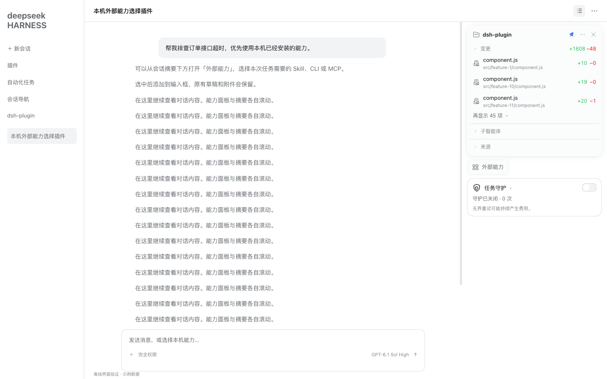

# 任务守护 · Task Guardian

按会话保存开关，在 **DSH 原生 normal 处理链结束、预算耗尽或明确不处理该次失败后**，接管能确认的临时模型请求故障。核心在 Host 中运行，切换会话或关闭浏览器页面不会取消 Host 的守护等待。

**本版 0.1.3 的实际范围：故障重试可执行；重启恢复提供证据审查，普通选项问题提供持久倒计时，两者在当前 API 下均保持人工确认。** 开启后两项会保存偏好，不代表本版能够自动恢复或自动提交普通问题答案。

## 入口与设置

**任务守护直接显示在会话摘要下、“外部能力”按钮的下一行**。卡片显示当前会话开关、状态、失败计数及下次重试倒计时；点击卡片标题打开原生“任务守护”详细设置页签。“开始”页不再提供任务守护入口。

此位置由同仓库的 Capability Selector 0.1.2+ 声明 `capability-selector.accessories` 原生子插槽，任务守护通过该插槽加入其正常纵向布局。与 Session Summary 0.3.2+ 配合时，外部能力按整列实测高度为摘要预留空间，摘要增长、拖动、缩放和附件卸载都会重新排布。任务守护不查询同伴插件 DOM，不覆盖既有面板；开关和 Host 守护设置沿用原值。

显示此入口需要同时启用上述版本的“外部能力”；摘要未安装或关闭时，整列随“外部能力”使用原有页头回退位置。



位置预览来自隔离浏览器中的真实产品组件与示例数据；当前用户 GUI 仍需加载更新版本。极短的 320×190 窗口只显示任务守护标题和开关，摘要会被明显压缩。

三个会话设置从 0.1.3 起都默认开启，适用于新会话及尚未保存设置的会话。已保存的设置（包括手动关闭）继续优先；“登录后启动 DSH”不在此次默认开启范围内，保持独立设置：

| 设置 | 本版行为 |
|---|---|
| 任务守护 | 开启明确临时模型请求故障的无界重试；可能持续产生费用 |
| 异常退出后自动恢复 | 保存事前偏好；重启时读取原会话与守护记录，给出无需恢复、已停止或需要确认等结果。本版不自动启动任务 |
| 30 分钟后自动选择第一项 | 保存偏好，显示原始问题创建时间起 30 分钟倒计时。本版通用问题到期后继续等待人工回答 |

后两项只有主开关开启时才生效；主开关关闭保留子设置，取消尚未发出的守护重试，不调用 `agent.cancel()`。每个会话独立保存；fork 按新会话应用默认值，不复制父会话保存的选择和运行记录。模型只能调用 `task_guardian_status` 读取本会话状态，没有配置、恢复、作答或系统启动项授权工具。

## 故障重试

- 当前核实版本：`@deepseek-ai/dsh-llm-retry@0.2.1-rc.3`，`llmRetry` projection stateVersion 1。运行时读取安装包版本；版本无法确认或不支持时守护停用，界面说明原因。升级 Harness 后需要重新核实。
- `agent/request-error` 使用外层 `prepend` waterfall，先 `await next()`，保留原生/其他插件的决策。返回未处理后，在核实当前原生策略和投影格式的前提下，区分原生预算耗尽、原生错误码列表不覆盖、有效 Retry-After 超原生上限这三种接管边界；之后仍必须通过临时错误分类。原生仍有适用预算时不抢占；缺少原生策略或状态时保守停止并显示原因。
- pi-ai 的 `PI_AI_ERROR` 是包装码，可能包含并发/频率限流、过载、超时、流传输失败，也可能是认证、余额、参数或未知错误，不能整体列为可重试。0.1.3 统一解析受限 SDK 前缀、保留的 HTTP 状态和结构化错误，覆盖明确的 Sub2API 并发/队列拒绝及其他可确认暂态；永久和歧义证据仍优先。完整范围与公开源码依据见[错误分类表](docs/pi-ai-errors.md)。
- **开启守护不会自动重放已经结束的失败轮次。** 若失败后才开启，需要在这个已开启的会话重新发起请求。状态面板显示最近失败时间、开启时间及未接管原因；“原生 API 版本匹配”仅说明当前接口版本受支持，不保证所有错误都会重试。
- 不改写原生 retry 配置。原生 `always` 永不耗尽，守护不介入；它自身可能重试永久错误，建议用户使用原生 normal 模式。
- 超时、流空闲超时、明确临时网络中断、临时服务错误、明确临时并发/频率限流、意外空响应可接管。认证、权限、余额/长期配额、参数、模型/地址、内容限制等永久信息优先排除；未知错误停用接管。裸 429、宽泛 TRANSPORT/NETWORK 不足以判定临时。
- `LlmFailure` 实际仅保留 code、message、status、providerRetryAfterMs 等字段。原始 headers/body/cause 可能已经被上游适配器丢弃；插件无法识别已丢失的信息。message 内保留下来的结构化永久错误同样优先排除。
- 基准 30 秒、60 秒、120 秒、240 秒，之后 300 秒；±10% 随机抖动且本地结果不超过 300 秒。有效服务端 Retry-After 是最低等待，可超过 5 分钟；超长等待分段执行以避开 Node 定时器上限。
- 次数与总时长不设业务上限；每次等待前持久保存计划。同一步请求重试由原生 loop 执行，不重放工具、不切换模型、不提高权限。成功响应及轮次边界清除连续失败计数。用户 Stop 的原生 abort 信号、关闭守护、插件卸载均取消等待。

## 恢复审查与风险

重启只审查预先开启主开关和恢复偏好的记录，使用 `sessionQuery.observeSession` 和纯日志投影，**不激活 Agent、不提交自动用户消息、不调用 goal resume、不重放工具**。

已停止、aborted、完成、暂停、目标清除等记录优先；缺失、不一致、工作区不可用、工具结果未知或失败，均需要人工处理。未结束状态不能证明断电，也可能来自崩溃或强退。

官方 `goals.resume(agent, ref)` 在技术上可调用，但当前没有完整的持久预授权与撤销 fence 契约；模型的 `update_goal resume` 又要求直接人类输入。插件不伪造人类输入，不把 active/disarmed 当授权。当前版本选择需要确认，而非声称 Host API 机械禁止所有未来的合法恢复适配器。

`tool/call` 已存在但缺少可靠结果，或原生修复结果为 `TOOL_OUTCOME_UNKNOWN`，表示外部操作可能已经完成；应先核实实际效果。原生日志中的停止记录存在落盘窗口：idle Stop 没有独立事件，Stop 后立即断电也可能尚未记录。不能承诺 100% 区分停止与断电。

授权、撤销和运行状态共用一个持久记录/递增版本；排队写入不会让旧重试覆盖已持久撤销。原生存储提供原子文件替换和 fsync；Windows 使用 libuv rename，缺少专门的 write-through 保证。写入失败后自动动作停用。跨进程用当前数据 home 派生的回环 TCP 端口作 OS 排他锁；它不提供 HTTP 服务，端口冲突会保守停用，进程退出后由 OS 释放。

## 问题计时与自动选择限制

从真实 `tool/call.time` 起算 30 分钟；PTC 需要真实 dispatch-start 时间。不能确认创建事件时保持等待，不从刷新或重启时间重新起算。open 转 continued 保留原始时钟，已回答/关闭问题不再显示；fork 不继承旧题或时钟。

原生通用问题没有结构化风险字段；选项顺序、推荐标记和关键词不能证明低风险。`userQuestions.answer` 仅支持 continued，需整批提交，来源固定为 `user-question-reply`，没有 automatic 或持久幂等事务参数。open 通过原始 waterfall 答复，属于不同生命周期。

因此本版不注册自动审批 answerer，不调用普通问题自动 answer；无选项、多选、自由输入及不完整批次明确排除，其他题也因缺少可信风险/自动来源契约保持人工回答。即使设置已开启，仍会显示到期与阻止原因。未来可自动选择时，语义应为 **第一个选项，不一定是推荐项**；不能将本版倒计时宣称为已完成自动作答功能。

## 登录后启动

详细设置页有独立的全局“登录后启动 DSH”开关，默认关闭，安装不会修改系统登录配置。

- macOS：当前用户的 LaunchAgents 目录，原创固定标签的托管 plist，调用系统 launchctl enable；下次登录生效，不在当前任务运行时另启 DSH。关闭只移除内容带本插件标记的托管文件。
- Windows：固定名称的 HKCU Run 注册表项，使用 reg.exe 参数数组，无 shell 拼接，不改 HKLM。
- 需要 Host 能识别 Desktop 应用路径；普通 Node/Web Host 无法确认时不允许启用。
- 断电后仍需系统开机、用户登录、磁盘解锁；插件不能保证自动开机或登录。登录启动 DSH 不等于已授权自动恢复所有任务。

## 安装、开发与验证

插件是原生 ESM JavaScript，无运行时第三方依赖，Node.js 22+。

优先在原生插件管理器的“安装第三方插件”中填写本目录绝对路径，由管理器完成依赖安装和 bundle 选择。命令行可以先添加依赖：

```sh
dsh plugin --profile desktop add /absolute/path/dsh-plugin/task-guardian
```

该 CLI 只转发包管理器操作，随后仍需在原生插件管理器启用任务守护 bundle。安装后刷新原有 DSH 页面；如果插件管理器报告需要重启，等任务结束后再重启。不要另启 Web 服务代替当前 GUI。

```sh
npm run check
npm test
npm run test:integration
npm run test:browser          # 真实 React/主题/三个产品组件，隔离 Chrome 与示例会话
npm pack --dry-run
```

测试从本机安装包只读提取原生依赖到本仓库已有的隔离运行时；它们不修改用户会话或调用真实上游模型。启动项测试在临时目录和模拟系统命令上进行，安装不会启用真实登录项。完整验证情况与未覆盖场景见 [验收记录](docs/验收记录.md)。
